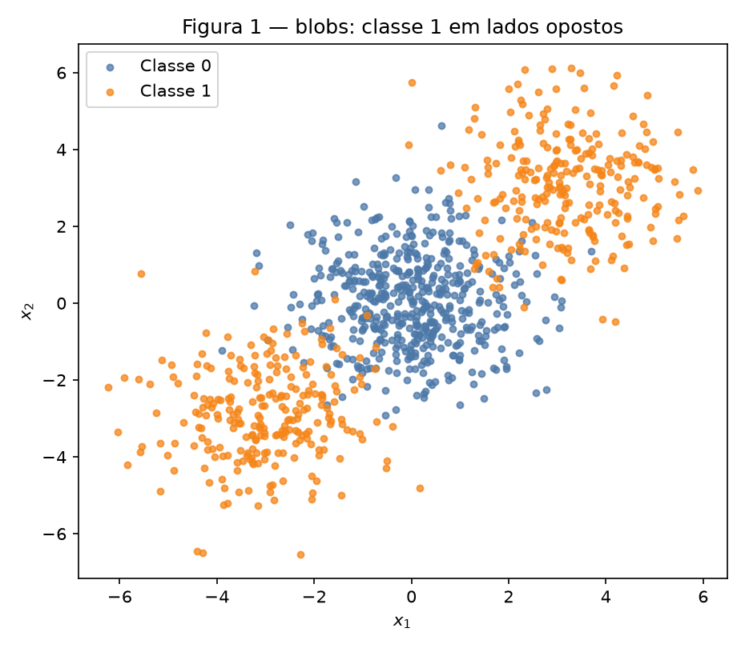
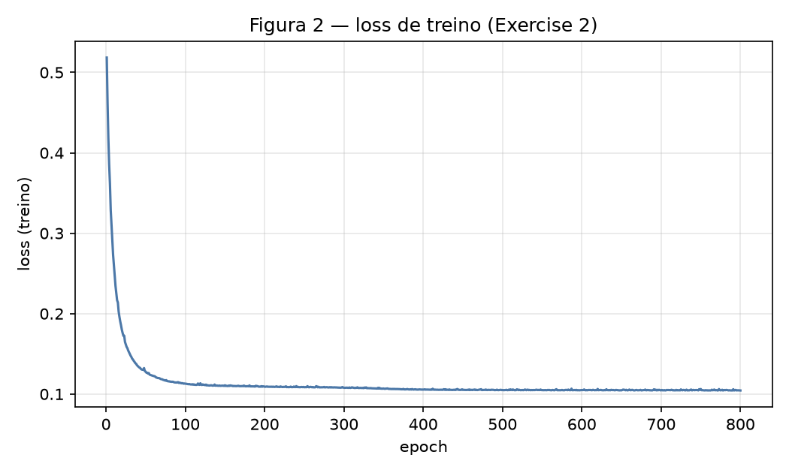
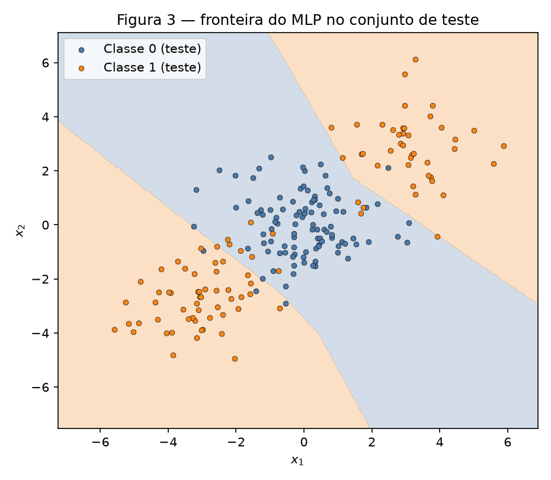
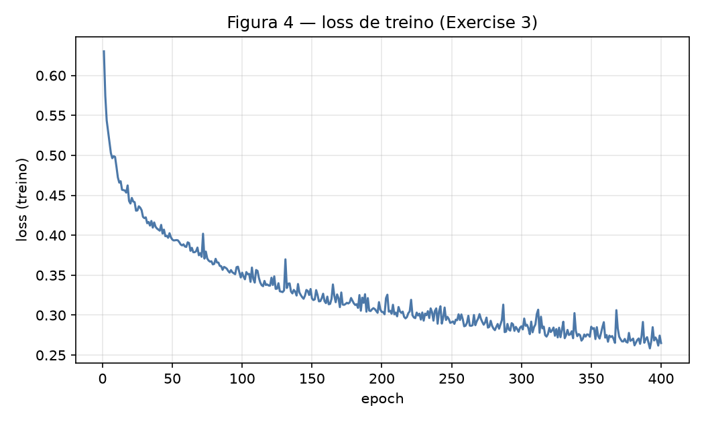
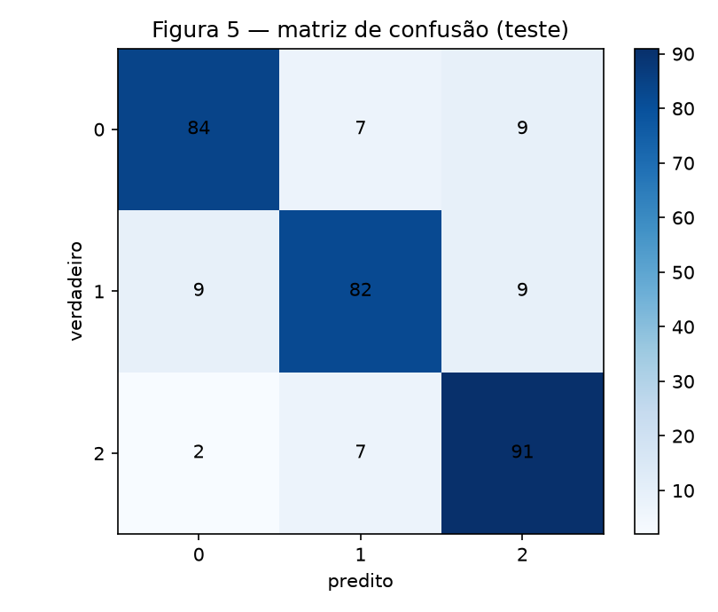
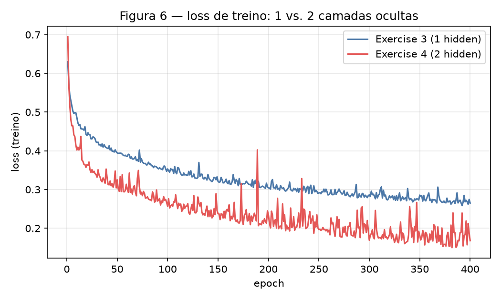

# 3. MLP

!!! abstract "Enunciado"

    [Exercises → MLP (2026.2)](https://insper.github.io/ann-dl/2026.2/exercises/mlp/){:target='_blank'}

Semente `rng = np.random.default_rng(42)` para inicializar pesos e embaralhar
minibatches. `sklearn` só gera dados, faz o split, a regressão logística de
baseline e a matriz de confusão. Forward, loss, backward e `update` são os
**mesmos métodos** nos Exercises 2, 3 e 4 — muda o vetor `sizes`, o tipo da
saída (`binary` / `multiclass`) e os hiperparâmetros.

``` { .python .copy .select linenums='1' title="docs/exercises/mlp/code/mlp.py" }
--8<-- "docs/exercises/mlp/code/mlp.py"
```

## Exercise 1

### One Step of Backpropagation, by Hand

MLP $2 \to 2 \to 1$, $\tanh$ nas duas camadas, $L=(y-\hat y)^2$,
$\mathbf{x}=[0{,}5,\,-0{,}2]^\top$, $y=1$, $\eta=0{,}3$.
Convenção: $\mathbf{z}^{(1)}=\mathbf{W}^{(1)}\mathbf{x}+\mathbf{b}^{(1)}$,
linhas de $\mathbf{W}^{(1)}$ = neurônios. Números com **4 casas** (e um
dígito extra nos intermediários).

### A — Forward pass

$$
\mathbf{z}^{(1)}
=
\begin{bmatrix}0.3 & -0.1\\ 0.2 & 0.4\end{bmatrix}
\begin{bmatrix}0.5\\ -0.2\end{bmatrix}
+
\begin{bmatrix}0.1\\ -0.2\end{bmatrix}
=
\begin{bmatrix}0.15+0.02\\ 0.10-0.08\end{bmatrix}
+
\begin{bmatrix}0.1\\ -0.2\end{bmatrix}
=
\begin{bmatrix}0.2700\\ -0.1800\end{bmatrix}.
$$

$$
\mathbf{h}^{(1)}=\tanh(\mathbf{z}^{(1)})
=
\begin{bmatrix}\tanh(0.2700)\\ \tanh(-0.1800)\end{bmatrix}
=
\begin{bmatrix}0.2636\\ -0.1781\end{bmatrix}.
$$

$$
u^{(2)}
=
[0.5,\,-0.3]\,\mathbf{h}^{(1)}+0.2
=
0.5\cdot 0.2636 + (-0.3)\cdot(-0.1781)+0.2
=
0.1318+0.0534+0.2
=
0.3852.
$$

$$
\hat y=\tanh(0.3852)=0.3672,
\qquad
L=(1-0.3672)^2=0.4004.
$$

### B — Backward pass

$L=(y-\hat y)^2$ $\Rightarrow$
$\partial L/\partial\hat y=-2(y-\hat y)=-2(0.6328)=-1.2655$.

Derivada do $\tanh$: $1-\tanh^2(u^{(2)})=1-\hat y^2=1-0.1349=0.8651$.
Cadeia:

$$
\frac{\partial L}{\partial u^{(2)}}
=
\frac{\partial L}{\partial\hat y}\,(1-\hat y^2)
=
(-1.2655)\cdot 0.8651
=
-1.0948.
$$

Camada de saída ($\mathbf{W}^{(2)}$ é um vetor linha):

$$
\frac{\partial L}{\partial\mathbf{W}^{(2)}}
=
\frac{\partial L}{\partial u^{(2)}}\,\mathbf{h}^{(1)}
=
-1.0948\cdot
\begin{bmatrix}0.2636\\ -0.1781\end{bmatrix}
=
\begin{bmatrix}-0.2886\\ 0.1950\end{bmatrix}^\top,
\qquad
\frac{\partial L}{\partial b^{(2)}}
=
-1.0948.
$$

Propagação para a oculta:

$$
\frac{\partial L}{\partial\mathbf{h}^{(1)}}
=
\frac{\partial L}{\partial u^{(2)}}\,\mathbf{W}^{(2)}
=
-1.0948\cdot[0.5,\,-0.3]
=
[-0.5474,\,0.3284].
$$

$$
\frac{\partial L}{\partial\mathbf{z}^{(1)}}
=
\frac{\partial L}{\partial\mathbf{h}^{(1)}}\odot\bigl(1-(\mathbf{h}^{(1)})^2\bigr).
$$

$1-h_1^2=1-0.0695=0.9305$, $1-h_2^2=1-0.0317=0.9683$, logo

$$
\frac{\partial L}{\partial\mathbf{z}^{(1)}}
=
[-0.5474\cdot 0.9305,\; 0.3284\cdot 0.9683]
=
[-0.5094,\,0.3180].
$$

$$
\frac{\partial L}{\partial\mathbf{W}^{(1)}}
=
\frac{\partial L}{\partial\mathbf{z}^{(1)}}\,\mathbf{x}^\top
=
\begin{bmatrix}-0.5094\\ 0.3180\end{bmatrix}
[0.5,\,-0.2]
=
\begin{bmatrix}
-0.2547 & 0.1019\\
0.1590 & -0.0636
\end{bmatrix},
\qquad
\frac{\partial L}{\partial\mathbf{b}^{(1)}}
=
[-0.5094,\,0.3180].
$$

### C — Parameter update

$\theta\leftarrow\theta-\eta\,\partial L/\partial\theta$ com $\eta=0.3$:

$$
\mathbf{W}^{(2)}
=
[0.5,\,-0.3]-0.3[-0.2886,\,0.1950]
=
[0.5866,\,-0.3585],
\qquad
b^{(2)}=0.2-0.3(-1.0948)=0.5284.
$$

$$
\mathbf{W}^{(1)}
=
\begin{bmatrix}0.3 & -0.1\\ 0.2 & 0.4\end{bmatrix}
-
0.3
\begin{bmatrix}-0.2547 & 0.1019\\ 0.1590 & -0.0636\end{bmatrix}
=
\begin{bmatrix}0.3764 & -0.1306\\ 0.1523 & 0.4191\end{bmatrix},
$$

$$
\mathbf{b}^{(1)}
=
[0.1,\,-0.2]-0.3[-0.5094,\,0.3180]
=
[0.2528,\,-0.2954].
$$

Um segundo forward com esses parâmetros dá $L'=0.0834<0.4004$. A loss
**desce**: o passo foi exatamente $-\eta\nabla L$, portanto (para $\eta$
pequeno o bastante) $L$ diminui na direção de descida.

## Exercise 2

### Binary Classification a Straight Line Cannot Do

### A — Generate the data

`make_blobs` com os três centros do enunciado, `y=(c>0)` — a classe 1
fica nos dois extremos da diagonal, a classe 0 no meio. Split 80/20
estratificado, `random_state=42`.


/// caption
**Figura 1** — 1000 pontos. Qualquer reta que acerta um laranja erra o
outro, ou corta o azul.
///

### B — Establish the baseline

`LogisticRegression` no treino, avaliada no teste:
**47,50%**. Abaixo de 50%, como o enunciado antecipa (~48%).

### C — Implement the MLP

Arquitetura `[2, 16, 1]`: oculta ReLU, saída sigmoide, loss BCE.
SGD em minibatches de 64, $\eta=0.08$, **800** epochs.
Acurácia no teste: **92,50%** (faixa 90–93%).


/// caption
**Figura 2** — BCE de treino. Cai rápido até ~100 epochs e assenta.
///


/// caption
**Figura 3** — região laranja (classe 1) em **dois cantos opostos**;
faixa azul (classe 0) no meio. Pontos: conjunto de teste.
///

### D — Analysis

O baseline linear está **abaixo** de 50% porque a geometria é a de um
XOR contínuo: a classe 1 não é um lado da reta, são **dois** lados. Uma
reta que classifica o canto superior-direito como 1 empurra o
inferior-esquerdo para 0 — e vice-versa. No meio ainda mora a classe 0,
então qualquer corte único acerta um cluster laranja e erra o outro
*mais* os azuis da fronteira. Resultado: pior que o chute.

A Figura 3 mostra o que a camada oculta compra: a região da classe 1 é
**desconexa** (duas componentes). Isso não é um semiplano
$\mathbf{w}^\top\mathbf{x}+b>0$. Os 16 ReLUs recortam o plano em
polígonos e a saída combina dois deles; daí os 92,5%.

## Exercise 3

### Multi-Class, Same Network

### A — Generate the data

`make_classification`: 1500 amostras, 4 features informativas, 3 classes,
2 clusters por classe, `class_sep=1.0`, `random_state=42`. Split 80/20
estratificado com a mesma semente.

### B — Adapt the network

Mesmo `forward` / `backward` / `update`. Só mudam `sizes=[4, 32, 3]` e
`output="multiclass"` (softmax + CCE).

**Derivação de $\partial L/\partial\mathbf{u}$.** Para uma amostra,
$p_k=e^{u_k}/\sum_j e^{u_j}$ e $L=-\sum_k y_k\log p_k$ com
$\sum_k y_k=1$, $y_k\in\{0,1\}$.

$$
\log p_k = u_k - \log\sum_j e^{u_j},
\qquad
\frac{\partial\log p_k}{\partial u_i}
=
\mathbf{1}_{k=i}-p_i.
$$

$$
\frac{\partial L}{\partial u_i}
=
-\sum_k y_k(\mathbf{1}_{k=i}-p_i)
=
-y_i + p_i\sum_k y_k
=
p_i-y_i.
$$

No batch, a média dá $(\hat{\mathbf{y}}-\mathbf{y}_{\text{oh}})/N$ — a
mesma forma que BCE+sigmoide no caso binário, por isso o `backward` não
foi reescrito.

### C — Train and evaluate

`[4, 32, 3]`, 259 parâmetros, $\eta=0.08$, 400 epochs, batch 64.
Acurácia no teste: **85,67%** (faixa 83–86%).
Baseline linear no mesmo split: **66,33%** (~66%).


/// caption
**Figura 4** — CCE de treino, uma camada oculta.
///


/// caption
**Figura 5** — 300 pontos de teste. Diagonal dominante; os erros se
espalham nas três classes.
///

### D — Analysis

A maior célula fora da diagonal vale **9**, empatada em
$(0\to 2)$, $(1\to 0)$ e $(1\to 2)$. Somando os dois sentidos, os pares
**0–1** e **1–2** empatam com 16 erros; 0–2 tem 11. O par mais
confundido, portanto, envolve a **classe 1** com cada vizinha.

O gerador cria **6 clusters em 4D** (2 por classe). Com `class_sep=1.0`
esses clusters se encostam: um dos dois modos da classe 1 pode cair
perto de um modo da 0, o outro perto da 2 — daí a classe 1 aparecer nos
dois pares. A camada oculta sobe o baseline de 66,3% para 85,7%: a
logística só corta o $\mathbb{R}^4$ em 3 semi-espaços; o ReLU 32-D
separa modos da mesma classe que não são convexos juntos.

## Exercise 4

### Does a Second Hidden Layer Help?

Mesmos dados, split, $\eta=0.08$, 400 epochs e batch 64. Só a
profundidade muda: `[4, 32, 32, 3]` (1315 parâmetros).

### A — Train the deeper network

Acurácia no teste (mesmo fluxo de `rng` após o Exercise 3): **86,33%**.

### B — Compare


/// caption
**Figura 6** — a rede mais profunda desce mais no **treino** e oscila
mais; isso não se traduz em melhor teste na média das sementes.
///

Run principal (figuras):

| hidden layers | parâmetros | train loss final | test accuracy |
|---------------|------------|------------------|---------------|
| Exercise 3 (1) | 259 | 0,2651 | 85,67% |
| Exercise 4 (2) | 1315 | 0,1680 | 86,33% |

Três inicializações seguintes do **mesmo** `rng` (média das acurácias de teste):

| | run 1 | run 2 | run 3 | média |
|--|------:|------:|------:|------:|
| Ex. 3 | 83,67% | 86,67% | 84,00% | **84,78%** |
| Ex. 4 | 84,33% | 84,33% | 82,67% | **83,78%** |

Diferença média (Ex. 4 − Ex. 3): **$-1{,}00$ ponto percentual**.

### C — Analysis

A rede fundo **não ganha** na média — e no treino ela até *parece*
melhor (Figura 6, loss 0,17 vs. 0,27). Isso é o resultado esperado.

Seis clusters gaussianóides em 4D pedem uma fronteira só um pouco não
linear. Uma oculta de 32 ReLUs já recorta isso. A segunda oculta
compõe as recortes (funções mais “quebradas”), o que reduz a loss de
treino — 5× mais parâmetros cabem o ruído do split — mas o teste não
sobe. O custo extra é otimização: o mesmo SGD, o mesmo $\eta$ e o
mesmo orçamento agora atravessam mais não-linearidades, daí a curva
vermelha mais ruidosa e a média pior.

Profundidade pagaria em dados cuja decisão **precisa** de composição
(espirais, tabuleiro, hierarquia de XOR). Aqui o gerador não pede isso.

## Results summary

| # | Quantity | Value |
|---|----------|-------|
| 1 | Ex. 1 — $\mathbf{z}^{(1)}$ e $\mathbf{h}^{(1)}$ | $[0.2700,\,-0.1800]$, $[0.2636,\,-0.1781]$ |
| 2 | Ex. 1 — $u^{(2)}$, $\hat y$ e $L$ | $0.3852$, $0.3672$, $0.4004$ |
| 3 | Ex. 1 — parâmetros atualizados | $\mathbf{W}^{(2)}=[0.5866,\,-0.3585]$, $b^{(2)}=0.5284$; $\mathbf{W}^{(1)}=\begin{bmatrix}0.3764 & -0.1306\\ 0.1523 & 0.4191\end{bmatrix}$, $\mathbf{b}^{(1)}=[0.2528,\,-0.2954]$ |
| 4 | Ex. 2 — linear baseline test accuracy | 47,50% |
| 5 | Ex. 2 — architecture and test accuracy | `[2, 16, 1]`, 92,50% |
| 6 | Ex. 3 — architecture and test accuracy | `[4, 32, 3]`, 85,67% |
| 7 | Ex. 3 — most-confused class pair | 0–1 e 1–2 (16 erros cada); célula máxima 9 |
| 8 | Ex. 4 — architecture and test accuracy | `[4, 32, 32, 3]`, 86,33% |
| 9 | Ex. 4 — accuracy difference against Ex. 3 (mean, 3 seeds) | $-1{,}00$ p.p. |

## Discussão

O ponto fácil de errar no Exercise 1 é a orientação de $\mathbf{W}^{(1)}$:
linhas = neurônios, $\partial L/\partial\mathbf{W}^{(1)}=(\partial L/\partial\mathbf{z})\mathbf{x}^\top$.
No código, o atalho $\partial L/\partial\mathbf{u}=\hat y-y$ vale para os
dois pares (sigmoide+BCE e softmax+CCE) — por isso o mesmo `backward`
serve nos quatro exercícios depois do 1.

## Conclusão

A camada oculta compra regiões **desconexas** (Exercise 2) e modos
não-convexos por classe (Exercise 3). Uma *segunda* oculta, no mesmo
orçamento, não compra acurácia neste gerador: só loss de treino menor e
mais variância entre sementes.
